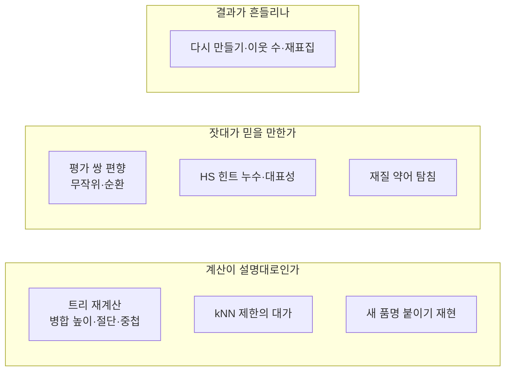

# 7. 검수에서 찾은 것

빨리 결론 내기보다 꼼꼼히 확인하려고, 만든 결과를 원래 코드와 **따로 구현한 코드**로 다시 계산했다. 검수 스크립트 다섯 개와 단위 테스트(128개)를 한 명령으로 다시 돌릴 수 있다.

## 계산: 설명대로 만들어졌다

| 점검 | 결과 |
|---|---|
| 평균 연결 높이 | 벡터 합으로 다시 계산한 값과 차이 3e-7. 이웃 제한 때문에 생긴 역전 약 50회, 최대 0.019(절단 간격 0.025 미만) |
| 절단·중첩 | 22단 모두 일치, 포함관계 위반 0 |
| kNN 제한 | 이웃 밖이라 합쳐지지 못한 군집 쌍이 단마다 400~700쌍, 옮겨 갔을 BL 은 0.01~0.03% (추정) |
| 새 품명 붙이기 | 붙는 단 100% 재현. 머리 품명 하나 빼고 다시 붙이면 0.65 에서 98.2% 원래 군집 |
| 보고서 수치 | 표와 인용 수치 모두 일치 |

## 잣대: 고쳐야 할 곳이 나왔다

**① 범주 BA 가 무작위 쌍으로 부풀었다.** "다름" 쌍의 63% 가 무작위로 뽑은 쌍이었다. 무작위 쌍은 어떤 방법이든 쉽게 떼어 놓아 점수를 올린다. 전체 트리 0.45 에서 범주 BA 0.858 이 무작위를 빼면 0.790 으로 내려간다. 그 결과 범주 최적 기준도 0.45 에서 0.575 로 옮겨 갔다(둘의 차이는 유의하지 않음).

**② 평가 쌍이 OpenAI 쪽으로 기울어 있다.** 평가 쌍의 74% 가 트리를 만든 OpenAI kNN 이웃이다. OpenAI 이웃이 아닌 쌍만 보면 품목 F1 이 0.83 → 0.70 으로 떨어진다. 이 쌍들은 주로 동의어·약어처럼 OpenAI 가 이웃으로 보지 못한 경우라 트리가 놓치기 쉽다(추정).

**③ HS 힌트는 적다.** 힌트가 붙은 BL 은 전체의 0.41% 다. 품명에 코드가 남아 점수를 거저 얻는 누수는 막혀 있음을 확인했다.

**④ 재질 구분이 약하다.** 약어↔풀네임 쌍(PP ↔ POLYPROPYLENE)은 0.65 에서 27% 만 같은 군집이고, 재질이 다른 쌍(PP RESIN ↔ PE RESIN)은 24% 가 같은 군집이다. 둘이 거의 같다. 원인은 세 겹이다.

| 원인 | 근거 |
|---|---|
| 임베딩 | OpenAI 는 두 종류 쌍의 코사인 중앙값이 0.762 와 0.782 로 거의 같다. 삼중쌍 시험 OpenAI 0.66, Gemini 0.88 |
| 평균 연결 희석 | 약어 쌍의 84% 가 코사인 0.65 이상인데 같은 군집은 27% |
| 붙이기 규칙 | 재질만 바꾼 새 품명의 53% 가 원래 군집에 붙음(트리 병합은 14.5%) |

**⑤ 상품명이 아닌 품명.** "AS PER INVOICE", 빈 컨테이너, 개인 이삿짐처럼 상품이 아닌 품명이 BL 의 4.3% 다. 대부분 따로 모이고, 상품 군집에 섞인 몫은 전체 BL 의 0.2% 다.

## 흔들림: 안정적이다

같은 설정으로 다시 만들면 완전히 같고, 이웃 수를 15·60 으로 바꾸면 ARI 0.94~0.98, 표본 80% 로 다시 만들면 0.81~0.86 이다. 표본 80% 로 다시 만들어도 품목 F1 변화는 ±0.01 안이다.

## 그래서 바뀐 권고

| 항목 | 검수 전 | 검수 후 |
|---|---|---|
| 범주 기본 절단 | 0.45 (BA 0.867) | 0.55 — 무작위 제외 LLM 점수, HS 호 순도, 안정성을 함께 봄 |
| 범주 BA 정의 | 무작위 쌍 포함 | 무작위 제외 값을 함께 보고 |
| 임베딩 | OpenAI 하나 | 품목은 OpenAI, 범주는 결정 대기([8장](embedding-choice.md)) |

범주 절단 후보별 근거(전체 트리)다.

| 기준 | LLM BA (전체 / 무작위 제외) | HS 호 순도 | 재표집 ARI |
|---|---|---|---|
| 0.60 | 0.825 / 0.807 | 0.698 | 0.787 |
| 0.575 | 0.835 / 0.813 | 0.635 | 0.770 |
| **0.55** | 0.843 / 0.812 | 0.588 | 0.831 |
| 0.45 | 0.858 / 0.790 | 0.395 | 0.805 |

## 답해 볼 질문

- 검수에서 "계산이 맞나"와 "잣대가 맞나"를 나눠 본 이유는?
- 0.55 와 0.575 는 LLM 점수로는 같은데 0.55 를 고른 근거는?
