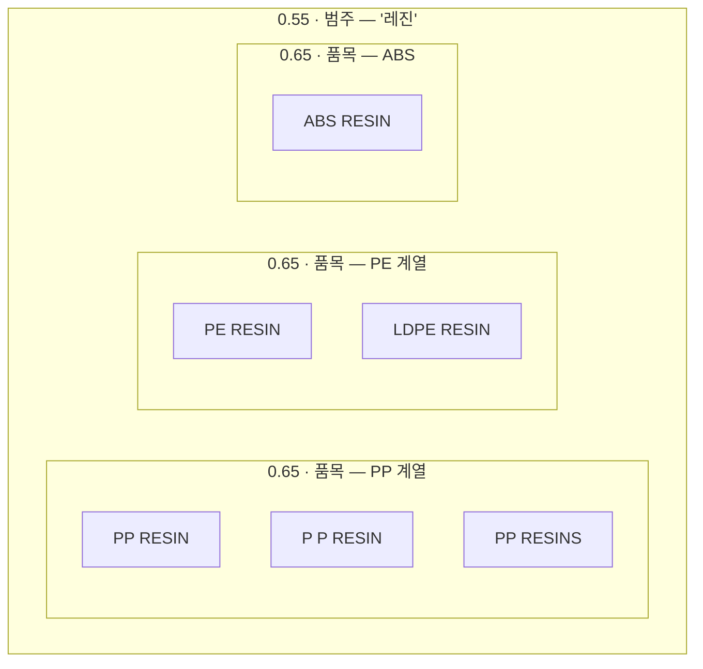
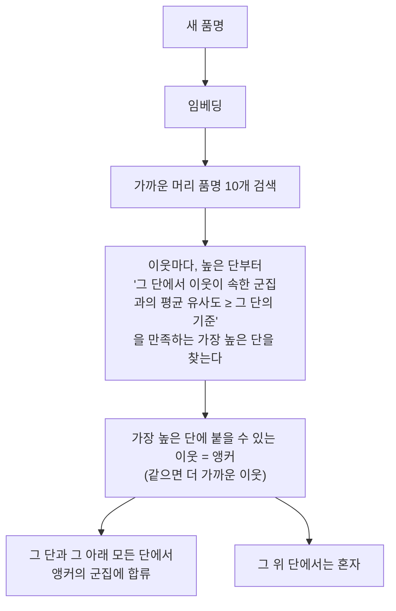

# 4. 절단과 새 품명 붙이기

## 절단: 트리를 군집으로

트리에서 기준선 \(t\) 를 정하고, 유사도 \(t\) 이상으로 합쳐진 것만 한 군집으로 보는 게 절단이다. 0.900 부터 0.375 까지 0.025 간격으로 22단을 잘라 둔다.

높이를 누적 최대로 고정했기 때문에 **아래 단 군집은 항상 위 단 군집 안에 통째로 들어간다**(중첩). 그래서 팀마다 다른 단에서 잘라도 서로 모순되지 않고, 한 팀의 군집을 다른 팀 군집으로 펼치거나 접을 수 있다.

그림은 구조를 보이기 위한 예시다. 실제로 어느 단에서 무엇이 합류하는지는 품명마다 다르고, 재질이 섞이는 문제가 있다([9장](decisions.md)).

## 왜 정답 하나가 아니라 트리인가

예전에 영업팀과 품목 분류를 맞춰 보다가, 팀마다 원하는 세분화가 달랐다. 어떤 팀은 "레진"으로 묶으면 충분했고 어떤 팀은 PP·PE·ABS 를 나눠 달라고 했다. 그 기준은 팀들도 명확히 몰랐다. 그래서 하나의 평평한 분류표를 강요하는 대신, 트리 하나를 주고 팀마다 깊이를 고르게 했다.

| 쓰임 | 권하는 절단 (OpenAI) | 근거 |
|---|---|---|
| 품목 — 같은 물건의 표기 변형 | 0.65 (0.60~0.65 평탄) | LLM 합의 쌍 F1 최고점 |
| 범주 — 팀이 볼 큰 묶음 | 0.55 | 무작위 쌍을 뺀 LLM 점수, HS 호 순도, 재표집 안정성을 같이 봄 ([7장](audit.md)) |

## 전체 트리에서 단별 모습

머리 그룹으로 만든 트리에 꼬리를 붙인 뒤의 전체(약 135만 그룹) 값이다.

| 기준 | 군집 수 | 2개 이상 군집 | 혼자인 그룹 | 최대 군집 BL 비중 | BL 90% 를 덮는 군집 수 | 꼬리가 붙은 비율 |
|---|---|---|---|---|---|---|
| 0.900 | 1,044,750 | 118,507 | 68.5% | 5.1% | 156,323 | 20.5% |
| 0.800 | 645,345 | 109,704 | 39.6% | 5.1% | 49,258 | 49.5% |
| 0.700 | 324,373 | 62,396 | 19.4% | 5.1% | 14,312 | 74.2% |
| 0.650 | 205,234 | 41,520 | 12.1% | 5.1% | 7,215 | 83.6% |
| 0.600 | 118,438 | 25,114 | 6.9% | 5.1% | 3,407 | 90.6% |
| 0.550 | 62,373 | 14,021 | 3.6% | 5.1% | 1,566 | 95.1% |
| 0.500 | 29,344 | 7,198 | 1.6% | 6.1% | 702 | 97.8% |
| 0.450 | 12,671 | 3,391 | 0.7% | 7.5% | 283 | 99.1% |
| 0.375 | 3,891 | 775 | 0.2% | 15.1% | 45 | 99.7% |

0.55 에서 BL 90% 를 군집 약 1,600 개가 덮는다. 가장 큰 군집은 0.525 까지 FABRIC 계열이고, 그 아래부터는 POLYPROPYLENE 계열이 커진다.

## 새 품명 붙이기 (꼬리)

1건짜리 품명과 앞으로 들어올 새 품명은 트리를 다시 만들지 않고 이미 있는 트리에 붙인다.

평균 유사도는 붙일 때 머리 품명만으로 계산한다. 먼저 붙은 꼬리는 군집 합에 더하지 않는다.

검수 결과다([7장](audit.md)).

- 붙는 단 계산은 따로 구현해 다시 돌렸을 때 100% 같았다.
- 머리 품명 하나를 빼고 다시 붙여 보면 0.65 에서 98.2% 가 원래 군집으로 돌아온다.
- 약점: "앵커 하나의 계보를 아래 단까지 그대로 물려받는" 규칙 때문에 아래 단에서 손해가 있다. 그리고 재질만 바꾼 품명(예: PP → PE)을 넣으면 53% 가 원래 군집에 붙는다. 트리에서 직접 합쳐질 때는 14.5% 다.

## 답해 볼 질문

- 중첩이 깨지면 팀별 절단에서 어떤 문제가 생기나?
- 붙이기 규칙이 재질 바꾼 품명을 트리보다 더 쉽게 받아들이는 이유는 무엇일까?
