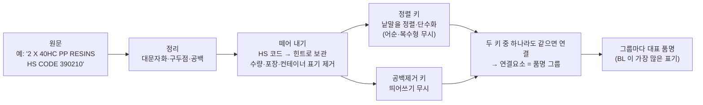

# 1. 데이터와 정리

## 무엇을 묶나

HHMITEM 은 BL 한 건마다 붙는 대표 품명이다. 운영 DB 에서 품명 원문과 그 품명이 쓰인 BL 건수만 뽑았다(BL 번호·고객 정보는 쓰지 않는다). 서로 다른 원문 표기가 약 178만 종이다.

분포는 한쪽으로 크게 쏠려 있다. 정리 후 품명 그룹의 약 72% 는 BL 1건에만 쓰였고, 상위 약 28% 의 그룹이 BL 의 91% 를 차지한다.

## 규칙 정리 (P0)

유사도를 재기 전에, 뜻이 같은 게 확실한 표기 차이는 규칙으로 먼저 합친다. 오타·약어·동의어처럼 판단이 필요한 것은 다음 단계(임베딩)로 넘긴다.

결과는 약 135만 그룹이다. 그룹마다 대표 품명, BL 건수, 원문 변형 수, 떼어 낸 HS 힌트, 규칙 플래그(USED·SCRAP·WASTE·RECYCLED·빈 컨테이너·혼합·모호·개인 이삿짐)를 들고 있다.

!!! info "규칙 정리의 알려진 한계"
    검수에서 몇 가지 규칙 실수를 찾았다. HS 정규식이 뒤따르는 수량을 함께 먹는 경우, PO·LC 번호를 지우다 모델 코드까지 지우는 경우, `AS PER INVOICE` 같은 무의미 문구가 남는 경우, `1 X 40HC` 처리가 뒤 숫자를 먹는 경우다. 영향은 BL 의 0.02% 이하로 추정되며 약어 정규화와 함께 고칠 예정이다.

## 머리와 꼬리

BL 건수는 원문 표기 하나가 아니라 **품명 그룹** 단위로 센다. 그룹에 든 모든 원문 표기(예: `PP RESIN`, `PP RESINS`, `pp resin,`)가 쓰인 BL 수의 합이다. 그래서 표기 두 개가 각각 BL 1건씩만 쓰였어도 같은 그룹이면 2건이 되어 머리로 간다(BL 2건짜리 그룹의 약 3분의 1이 이런 경우).

| 구분 | 기준 | 그룹 비중 | BL 비중 | 처리 |
|---|---|---|---|---|
| 머리 | 그룹 BL 합계 2건 이상 | 약 28% | 약 91% | 평균 연결 트리를 직접 만든다 |
| 꼬리 | 그룹 BL 합계 1건 | 약 72% | 약 9% | 트리에 넣지 않고 가까운 머리에 붙인다 |

꼬리를 트리에 바로 넣지 않은 이유는 둘이다. 평균 연결은 노드 수에 비례해 메모리가 늘어서, 135만 전체를 그대로 넣으면 약 23GB 가 필요하다는 추정이 나왔다(서버 메모리 상한 12GB). 또 1건짜리 품명은 오타·잡음 비중이 커서, 트리 뼈대는 여러 번 쓰인 품명으로 세우는 편이 낫다고 판단했다. 꼬리끼리만 묶이는 군집은 만들지 않았다. 그래서 1건짜리 표기 변형끼리는 머리 군집에 붙지 못하면 혼자 남는다.

## 파일럿 표본

방법을 30여 가지 비교하려고 전체가 아닌 표본으로 먼저 실험했다. 고른 방법만 전체에 돌렸다.

| 부분 | 그룹 수 | 목적 |
|---|---|---|
| BL 상위 | 60,000 | BL 대부분을 덮는다 |
| 주제 묶음 | 약 25,000 | 레진·김치·원단/원사·화학/위험물·스크랩 — 계층 예시를 보려고 일부러 넣음 |
| 나머지에서 무작위 | 30,000 | 꼬리 품질 확인 |
| 합계 | 115,375 | 전체 BL 의 80.8% |

!!! warning "표본은 무작위가 아니다"
    많이 쓰인 품명과 다섯 주제 쪽으로 기울어 있다. 표본의 군집 수를 비례로 늘려 전체를 짐작하면 안 된다.

## 답해 볼 질문

- 1건짜리 품명을 트리에 바로 넣지 않은 이유 두 가지는?
- 규칙 정리에서 오타를 합치지 않은 이유는?
