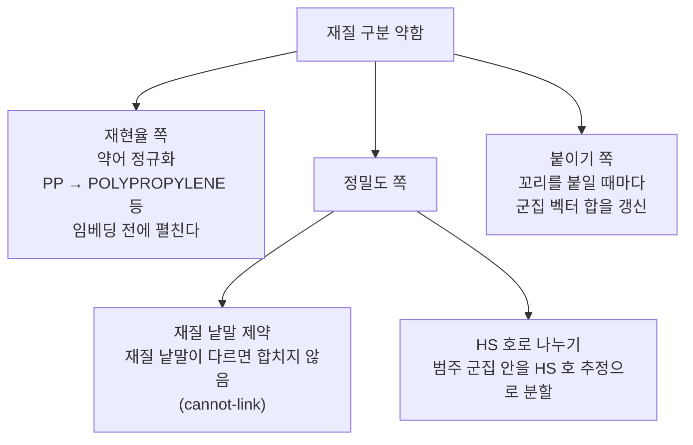

# 9. 약점과 결정할 것

## 알려진 약점

| 약점 | 모습 | 원인 |
|---|---|---|
| 재질 구분 | PP RESIN 과 PE RESIN 이 약어↔풀네임 쌍만큼 쉽게 합쳐진다 | 임베딩·평균 연결 희석·붙이기 규칙 세 겹 ([7장](audit.md)) |
| 동의어·약어·상표명 | IPA ↔ ISOPROPANOL, AL ↔ ALUMINUM, PMMA ↔ ACRYLIC SHEET 는 유사도 0.57~0.78 이라 어느 방법도 잇지 못한다 | 임베딩이 모르는 업계 용어 |
| 붙이기 계보 | 앵커 하나의 계보를 아래 단까지 물려받아, 아래 단에서 엉뚱한 군집에 붙는 몫이 있다 | 붙이기 규칙 |
| 상품명이 아닌 품명 | AS PER INVOICE, 빈 컨테이너 등 BL 의 4.3% | 원문 자체 |
| 평가 잣대 | LLM 라벨의 정확도를 모르고, HS 힌트는 BL 의 0.41% 뿐 | 사람 정답 없음 |

## 재질 보강안

한 가지로는 안 된다. 재현율(같은 물건을 합치기)과 정밀도(다른 재질을 떼기)를 따로 손봐야 한다.

!!! note "약어만 펼쳐서는 부족하다"
    풀네임끼리도 POLYPROPYLENE RESIN ↔ POLYETHYLENE RESIN 이 0.853 으로 가깝다. 약어 정규화는 같은 물건을 합치는 데는 도움이 되지만 다른 재질을 떼어 놓지는 못한다. 그래서 정밀도 쪽 장치가 같이 필요하다.

## 결정할 것

| # | 결정 | 선택지 | 지금 권고 |
|---|---|---|---|
| 1 | 범주 기본 절단 | 0.60 · 0.575 · 0.55 · 0.45 | 0.55 — LLM 점수·HS 호 순도·안정성이 모두 무난 |
| 2 | 범주 BA 정의 | 무작위 쌍 포함 / 제외 / 둘 다 표시 | 둘 다 표시, 판단은 무작위 제외 값으로 |
| 3 | 재질 보강안 | 약어 정규화 + 재질 낱말 제약 또는 HS 호 분할 + 꼬리 합 갱신 | 약어 정규화부터. 정밀도 장치는 두 안을 파일럿에서 비교 |
| 4 | HS 코드 추가 조회 | DB 의 HS 코드 컬럼을 더 가져와 HS 잣대 넓히기 | 운영 DB 조회라 범위 동의 후. 결정 5 의 판정에도 쓰인다 |
| 5 | 범주용 임베딩 | OpenAI 유지 / Gemini / 이어 쌓기 | OpenAI 유지, 4 의 결과나 소량 사람 확인으로 다시 판정 ([8장](embedding-choice.md)) |

모든 결정 밑에는 "범주란 무엇인가"라는 질문이 있다. 영업팀이 묶고 싶은 단위가 HS 호에 가까운지, "레진"이나 "섬유"처럼 더 넓은 단위인지에 따라 1·5번의 답이 달라진다. 이건 데이터가 아니라 업무가 정할 문제다.

## 답해 볼 질문

- 재질 문제를 임베딩 교체만으로 풀 수 없는 이유는?
- "범주"를 HS 호로 정의하면 결정 1·5 의 답은 각각 어떻게 기울까?
