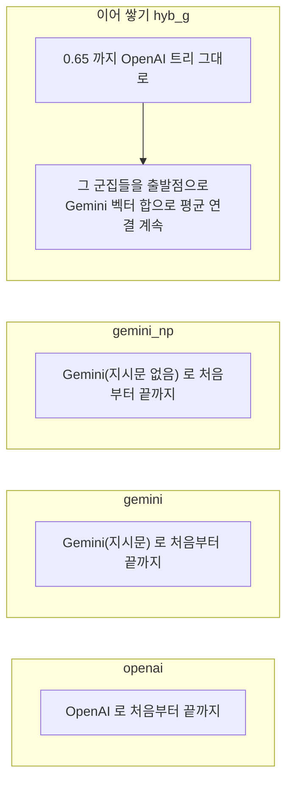

# 8. 범주용 임베딩 후보

[6장](results.md)에서 품목은 OpenAI, 범주는 Gemini 가 LLM 점수로 앞섰다. 그런데 트리 하나는 임베딩 하나로 만들어야 중첩이 유지된다. 그래서 두 수준을 다 잘할 후보를 파일럿에서 더 만들어 봤다. API 비용 없이 이미 있는 벡터로만 계산했다.

## 후보

이어 쌓기는 구조상 중첩이 깨지지 않는다. 0.65 아래는 OpenAI 트리 그대로이고, 그 위 군집은 0.65 군집들의 합집합이기 때문이다. 위쪽을 Gemini 지시문 없는 벡터로 이은 변형도 만들었다.

## 결과 1 — LLM 판정 (2겹 교차, 무작위 제외)

| 후보 | 품목 F1 | 범주 BA | 범주 BA (철자 이웃 쌍만) |
|---|---|---|---|
| openai | 0.818 | 0.795 | 0.829 |
| gemini | 0.786 | **0.849** | **0.875** |
| gemini_np | 0.806 | 0.828 | 0.819 |
| 이어 쌓기 (위쪽 Gemini) | **0.828** | 0.836 | 0.832 |
| 이어 쌓기 (위쪽 Gemini 지시문 없음) | 0.827 | 0.803 | 0.792 |

- Gemini 지시문 없음은 **탈락**이다. 기준을 낮추면 한 군집이 BL 의 53% 를 먹는 체이닝 비슷한 모습이 나온다.
- 이어 쌓기는 품목 F1 이 OpenAI 보다 0.009 높다(무작위 분할 200번 중 97~98% 우세). 작지만 꾸준한 차이다.
- 범주는 Gemini 가 가장 높고, 이어 쌓기가 그 사이다. 다만 편이 없는 철자 이웃 쌍에서는 이어 쌓기가 OpenAI 와 거의 같다(+0.003).

## 결과 2 — HS 힌트 (군집 수를 맞춘 비교)

파일럿에 HS 힌트가 있는 그룹은 약 4,500 개다. 군집 수가 비슷한 지점끼리 비교했다.

| 군집 수 | 후보 (기준) | LLM 범주 BA | HS 류 순도 | HS 호 순도 | HS 호 정밀도 | HS 호 재현율 |
|---|---|---|---|---|---|---|
| 약 7천 | openai (0.550) | 0.805 | **0.771** | **0.600** | **0.257** | 0.299 |
| | gemini (0.860) | **0.864** | 0.697 | 0.509 | 0.186 | **0.390** |
| | 이어 쌓기 (0.860) | 0.848 | 0.729 | 0.542 | 0.184 | 0.382 |
| 약 3.5천 | openai (0.500) | 0.794 | **0.711** | **0.498** | **0.138** | 0.400 |
| | gemini (0.840) | **0.862** | 0.570 | 0.368 | 0.100 | **0.466** |
| | 이어 쌓기 (0.840) | 0.819 | 0.633 | 0.412 | 0.115 | 0.474 |

**두 잣대가 반대 방향을 가리킨다.** LLM 판정으로는 Gemini 가 낫고, HS 순도로는 류(2자리)와 호(4자리) 모두에서 OpenAI 가 낫다.

!!! failure "틀린 가설 하나"
    처음에는 "LLM 의 범주 관례가 HS 호보다 넓어서 Gemini 가 유리할 뿐, 더 넓은 류에서는 차이가 줄 것"이라고 봤다. 류에서도 OpenAI 가 비슷한 폭으로 앞서서 이 가설은 맞지 않았다.

## Gemini 는 어떻게 다르게 묶나

같은 군집 수에서 Gemini 는 HS 재현율이 높고 정밀도·순도가 낮다. 묶음을 몇 개의 큰 군집으로 몰아 만든다는 뜻이다(2개 이상 군집이 더 적고, 혼자인 그룹은 더 많다).

류가 다른 힌트 그룹이 같은 군집에 든 쌍을 세면, 약 7천 군집 수준에서 OpenAI 26,544 쌍, Gemini 55,025 쌍으로 Gemini 가 약 두 배 섞는다. 늘어난 몫의 약 78% 는 같은 산업 블록 안이다.

| Gemini 가 특히 더 섞는 류 | 블록 |
|---|---|
| 54 인조필라멘트 ↔ 60 편물, 59 도포·기술용 직물, 55 인조스테이플, 52 면 | 섬유 |
| 28 무기화학 ↔ 32 염료·안료, 29 유기화학 ↔ 39 플라스틱·40 고무, 38 기타 화학 ↔ 39 | 화학·플라스틱 |

블록 안 섞임은 LLM 관례로는 "같은 범주"일 수 있어서, 처음 가설이 섬유·화학 블록에서는 일부 맞는다. 하지만 **블록 밖 섞임도 똑같이 두 배**(약 5.5천 → 1.2만 쌍)라 관례 차이만으로는 설명되지 않는다.

## 지금의 판단

| 질문 | 판단 |
|---|---|
| 묶는 규칙 | 평균 연결 — 확정 |
| 품목용 임베딩 | OpenAI. 이어 쌓기의 +0.009 는 진짜지만 작고, 새 품명마다 임베딩 API 두 곳을 불러야 하는 부담이 생긴다. 범주를 Gemini 로 가기로 할 때만 의미가 있다 |
| 범주용 임베딩 | **미결.** LLM 판정(음성 69쌍, 관례로 정의)은 Gemini, HS 힌트(그룹 약 4,500, 류·호 모두)는 OpenAI, 이어 쌓기는 둘 다 중간. 어느 잣대도 정답이 아니다 |
| 기본값 | OpenAI 유지 — 세 측정 중 둘(품목 F1, HS 순도)에서 이기고, 지는 하나가 가장 약한 잣대다 |
| 판정을 가를 방법 | ① DB 의 HS 코드 컬럼을 더 가져와 HS 잣대를 넓히기(조회 범위 동의 필요) ② 두 트리가 범주 기준에서 엇갈리는 쌍만 골라 사람이 소량 블라인드 확인 |

!!! info "재현"
    이 장의 수치는 비공개 리포의 임베딩 후보 점검(`embedding_choice_check.py` → `docs/embedding_choice.md`)으로 다시 만들 수 있다.

## 답해 볼 질문

- 같은 군집 수에서 재현율은 높고 정밀도는 낮다는 건 군집 모양이 어떻다는 뜻인가?
- LLM 판정과 HS 순도 중 하나를 버려야 한다면 어느 쪽이고, 그 이유는?
