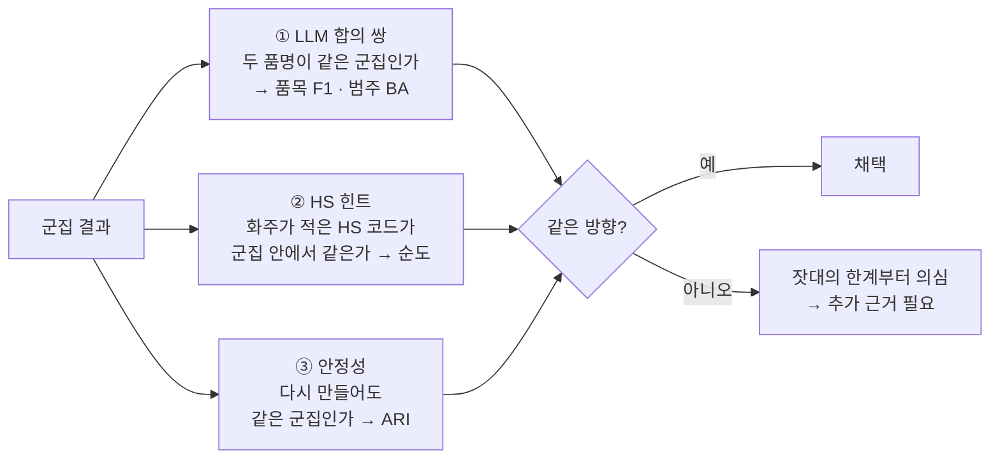
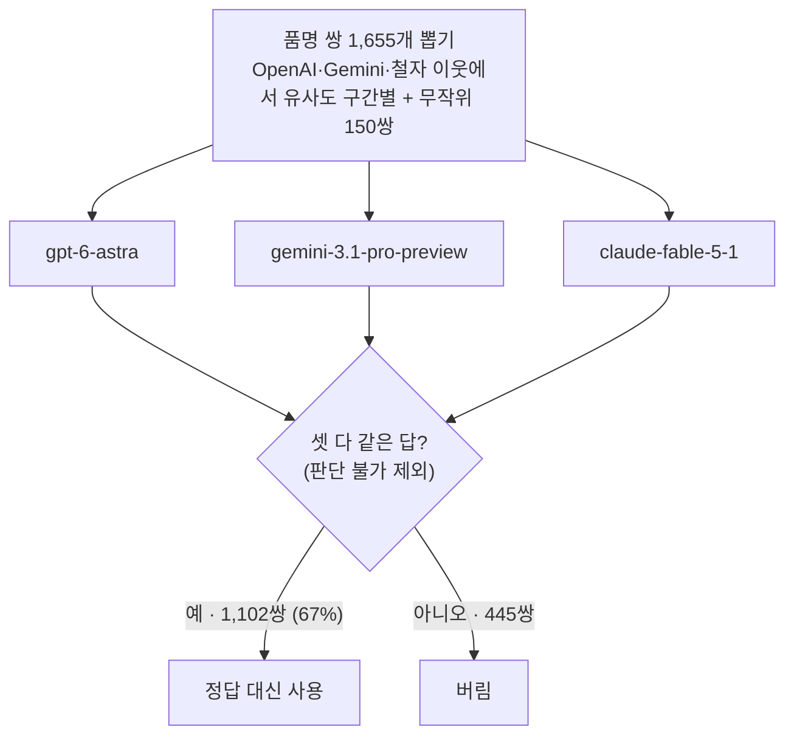

# 5. 라벨 없이 평가하기

사람이 만든 정답 라벨은 없다. 대신 성질이 다른 대용 잣대 세 개를 쓰고, 셋이 같은 방향을 가리키는지 본다. **어느 것도 정답이 아니다.**

## ① LLM 합의 쌍

### 만드는 법

세 모델에 같은 규칙문을 주고 네 가지 중 하나를 고르게 했다.

| 라벨 | 뜻 (규칙문 요약) |
|---|---|
| SAME_ITEM (같은 물건) | 오타·단복수·어순·약어·동의어·상표명 대 일반명, 등급·규격·색상·포장 차이 |
| SAME_CATEGORY (같은 범주) | 다른 제품이지만 영업팀이 같은 범주로 묶을 것 — "대략 HS 호 수준". PP 대 PE 수지, 형태·품종·소재 등급 차이 |
| DIFFERENT (다름) | 범주가 다름. 낱말이 겹쳐도(PP RESIN 대 PP WOVEN BAGS) |
| UNSURE (판단 불가) | 한쪽이 너무 모호함(GENERAL CARGO 대 MACHINE PARTS) |

경계가 애매한 경우는 관례로 정했다. 신품과 USED·SCRAP·RECYCLED, 부품과 완제품, 총칭과 그 하위 품목은 모두 SAME_CATEGORY 로 보게 했다.

### 점수

군집 결과에서 "두 품명이 같은 군집인가"를 예/아니오로 뽑아 LLM 라벨과 맞춘다.

| 수준 | 같음(양성) | 다름(음성) | 점수 |
|---|---|---|---|
| L1s 품목 | SAME_ITEM | SAME_CATEGORY, DIFFERENT | F1 |
| L2 범주 | SAME_ITEM, SAME_CATEGORY | DIFFERENT | BA |

- **정밀도**: 같은 군집에 넣은 쌍 중 실제로 같은 비율. **재현율**: 실제로 같은 쌍 중 같은 군집에 넣은 비율. **F1** 은 둘의 조화평균이다.
- **BA**(균형 정확도)는 양성을 맞힌 비율과 음성을 맞힌 비율의 평균이다. 범주 수준은 양성이 음성보다 훨씬 많아서, F1 을 쓰면 "전부 한 군집"이 0.906 이 나와 버린다. BA 는 그런 꼼수에 속지 않는다.
- **95% 신뢰구간**: 평가 쌍을 복원추출로 다시 뽑아 1,000번 재계산한 흔들림이다. 두 방법 차이의 구간이 0 을 품으면 차이가 있다고 말하지 않는다.
- **2겹 교차**: 평가 쌍을 반으로 나눠 한쪽으로 기준선을 고르고 다른 쪽으로 채점한다. 같은 쌍으로 기준을 고르고 채점하면 점수가 낙관적이 되기 때문이다.

### 이 잣대의 한계

!!! warning "LLM 라벨의 정확도는 잴 수 없다"
    사람이 확인한 정답이 없어서 라벨 자체의 오류율을 모른다. 알 수 있는 건 간접 증거뿐이다.

- 모델끼리 일치도(κ)는 같은 물건 여부만 보면 0.81~0.84, 네 라벨 전체로는 0.72~0.76 이다.
- 만장일치로 거르면 한 모델의 실수는 빠지지만, 같은 규칙문을 읽은 세 모델이 **같이 틀리는** 실수는 남는다.
- 애매한 3분의 1을 버렸으니 남은 쌍은 쉬운 쪽이고, 점수가 실제보다 좋게 나온다.
- **범주의 뜻은 규칙문의 관례다.** 신품↔스크랩, 부품↔완제품을 같은 범주로 보게 한 것은 실제 HS 호보다 넓다(예: PE 수지 3901호, PE 스크랩 3915호). 범주 BA 는 "정답률"보다 "그 관례를 얼마나 따르나"에 가깝다. 품목 수준은 정의가 비교적 분명해 덜 흔들린다.
- 평가 쌍은 이웃 쌍 위주다. 74% 가 OpenAI kNN 이웃이라 OpenAI 트리에 유리할 수 있다.
- "다름" 쌍의 63% 가 무작위 쌍이다. 무작위 쌍은 어느 방법이든 쉽게 떼어 놓아서 범주 BA 를 부풀린다. 무작위를 빼면 음성이 69쌍뿐이라, 3쌍 차이가 BA 0.02 다.
- HS 힌트로 LLM 라벨을 맞춰 보려 했으나 두 품명 모두 HS 코드가 있는 평가 쌍이 12개뿐이라 판단할 수 없었다.

## ② HS 힌트

화주가 품명에 HS 코드를 같이 적은 경우가 있다(예: `... HS CODE 390210`). 이 코드를 떼어 내 품명 그룹의 힌트로 둔다. 군집 안 힌트 코드가 얼마나 같은지를 류(앞 2자리)와 호(앞 4자리)에서 잰다.

| 지표 | 뜻 |
|---|---|
| 정밀도 | 같은 군집에 든 힌트 그룹 쌍 중 코드가 같은 비율 |
| 재현율 | 코드가 같은 쌍 중 같은 군집에 든 비율 |
| 순도 | 힌트 그룹이 2개 이상 든 군집마다 가장 많은 코드의 비중을 그룹 수로 가중 평균 — 큰 군집 하나에 덜 휘둘린다 |
| 우연 수준 | 무작위로 두 그룹을 골랐을 때 코드가 같을 확률 — 류 0.046, 호 0.006 |

한계도 있다. 힌트가 실제로 붙은 BL 은 전체의 0.41% 뿐이고, 화주 기재값이라 틀린 코드도 있다. 대신 LLM 이나 임베딩과 독립적으로 만들어진 값이라 어느 임베딩 편도 들지 않는다. 품명에 코드 숫자가 그대로 남아 점수를 거저 얻는 누수는 검사해서 막았다.

## ③ 안정성

같은 절차를 다시 돌려 군집이 얼마나 같은지를 ARI(우연을 보정한 분할 일치도, 1 이면 같음)로 잰다.

| 바꾼 것 | 0.65 | 0.55 | 0.45 |
|---|---|---|---|
| 같은 설정으로 다시 | 1.000 | 1.000 | 1.000 |
| 이웃 수 30 → 15 · 60 | 0.968 · 0.981 | 0.936 · 0.966 | 0.942 · 0.937 |
| 표본 80% 를 네 번 | 0.862 | 0.831 | 0.805 |

## 답해 볼 질문

- 범주 수준에서 F1 대신 BA 를 쓰는 이유는?
- LLM 판정과 HS 순도가 서로 다른 답을 내면 어느 쪽을 더 믿어야 할까? 각각의 약점은?
