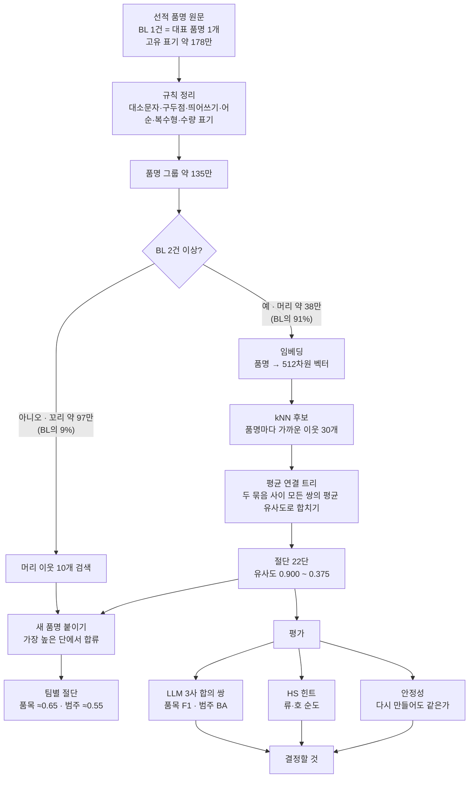

# 선적 품명 군집 — 큰 그림

BL 한 건에는 화주가 적은 대표 품명(HHMITEM)이 하나 붙는다. 같은 물건도 `PP RESIN`, `POLYPROPYLENE RESIN`, `P.P RESIN` 처럼 수십 가지로 적히고, 영업팀마다 원하는 묶음의 굵기도 다르다. 어떤 팀은 "레진"으로 한 번에 묶고 싶고, 어떤 팀은 PP·PE·ABS 를 나눠 보고 싶다.

그래서 정답 분류표 하나를 만드는 대신 **품명을 뜻으로 묶은 계층 트리**를 만들고, 팀마다 원하는 높이에서 자르게 했다. 사람이 붙인 정답 라벨은 없어서 평가는 LLM 합의 판정, 화주가 적은 HS 코드, 다시 만들었을 때의 안정성 세 가지로 했다.

!!! note "이 사이트에 대해"
    공부와 검토용 공개 문서다. 실데이터(BL 건수, 고객사, 내부 시스템 주소)는 넣지 않았고 비율과 일반 품명 예시만 쓴다. 코드와 원자료는 비공개 리포에 있다. 모든 점수는 사람 정답이 아닌 대용 잣대로 잰 **추정**이다.

## 전체 흐름

## 지금 상태

| 항목 | 상태 |
|---|---|
| 묶는 규칙 | 평균 연결 계층으로 확정. 다른 방법(단일 연결·Leiden·k-means·HDBSCAN)은 모두 유의하게 낮고 중첩 트리도 못 만든다 |
| 임베딩 | 품목 수준은 OpenAI 512 가 낫다. 범주 수준은 잣대에 따라 갈린다(LLM 판정은 Gemini, HS 류·호 순도는 OpenAI). "LLM 의 범주 관례가 넓어서"라는 설명은 류 결과로 기각됐다 — [8. 범주용 임베딩 후보](embedding-choice.md) |
| 전체 실행 | 135만 그룹 전체 트리와 새 품명 붙이기 완료, 검수 완료 |
| 화면 | 사내 탐색기·별자리 화면은 아직 파일럿 표본(11.5만 그룹, BL 80.8%) 기준 |
| 결정 대기 | 범주 절단 · 범주 BA 정의 · 재질 보강안 · HS 코드 추가 조회 · 범주용 임베딩 — [9. 약점과 결정할 것](decisions.md) |

## 공부 순서

앞 단계를 알아야 뒤가 읽히는 순서다. 각 장 끝에 "답해 볼 질문"을 달았다.

| 순서 | 장 | 다 읽고 답할 수 있어야 할 것 |
|---|---|---|
| 1 | [데이터와 정리](data.md) | 왜 1건짜리 품명은 트리에 바로 넣지 않았나 |
| 2 | [임베딩과 유사도](embedding.md) | 코사인 0.70 과 0.55 는 각각 어떤 묶음인가 |
| 3 | [평균 연결 트리](tree.md) | 단일 연결은 왜 거대 군집을 만들고, 평균 연결은 무엇을 포기했나 |
| 4 | [절단과 새 품명 붙이기](cut.md) | 팀마다 다른 굵기를 트리 하나로 어떻게 주나 |
| 5 | [라벨 없이 평가하기](evaluation.md) | LLM 판정 점수는 무엇을 재고, 무엇을 못 재나 |
| 6 | [방법 비교 결과](results.md) | 왜 같은 "유사도 0.65"가 알고리즘마다 다른가 |
| 7 | [검수에서 찾은 것](audit.md) | 예전 권고 0.45 는 왜 바뀌었나 |
| 8 | [범주용 임베딩 후보](embedding-choice.md) | 두 잣대가 다른 답을 내면 무엇을 믿나 |
| 9 | [약점과 결정할 것](decisions.md) | 재질 구분 문제는 임베딩으로 풀 문제인가, 규칙으로 풀 문제인가 |
