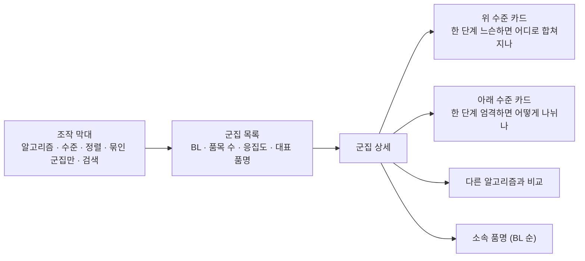

# 화면 보는 법

사내망에 두 화면이 있다. 군집을 표로 보는 **탐색기**와 3D 공간에서 보는 **별자리**다. 둘 다 아직 파일럿 표본(11.5만 그룹) 기준이라 군집 수와 BL 건수가 전체 트리 숫자와 다르다.

## 탐색기

| 항목 | 뜻 |
|---|---|
| 알고리즘 | "임베딩 + 규칙" 조합. 함께 쓴 방법은 처리 순서대로 + 로 잇는다(예: OpenAI + 평균 연결) |
| 수준 | 절단 기준(유사도 ≥ t). 알고리즘마다 눈금이 다르다 |
| BL | 그 군집 품명들이 쓰인 BL 수 |
| 품목 수 | 군집에 묶인 품명 그룹 수 |
| 응집도 | 군집 평균 벡터의 길이. 제곱하면 군집 안 품명 쌍의 평균 유사도다. **응집도 낮은 순** 정렬로 의심 군집부터 본다 |

## 별자리

| 요소 | 뜻 |
|---|---|
| 별 | 품명 그룹 하나. 클수록 BL 이 많다 |
| 위치 | 512차원 벡터를 UMAP 으로 3차원에 펼친 것. 가까울수록 대체로 뜻이 비슷하다 |
| 선 | 별자리마다 BL 상위 품명을 **원래 512차원 코사인**으로 이은 최소 신장 트리(가장 가까운 것끼리 고리 없이 최소한으로 이은 선) |
| 첫 화면 | BL 상위 별자리 10·30·60 개를 한 색의 선과 "번호. 이름" 표로. 이름이나 별에 마우스를 올리면 그 별자리만 금색 |
| 하나를 고르면 | 한 단계 엄격하게 했을 때 나뉘는 하위 별자리마다 색이 달라진다 |
| 기준 슬라이더 · ▶ 재생 | 기준을 낮추며 별자리가 합쳐지는 과정 |

!!! warning "긴 선 = 약한 연결? 반만 맞다"
    누가 누구와 이어졌는지는 실제 512차원 유사도로 정했다. 하지만 화면에서 선이 길어 보이는 건 UMAP 이 3차원에 펼치며 생긴 배치 때문일 수도 있다. 긴 선을 보면 양 끝 별에 마우스를 올려 이름이 같은 계열인지 확인한다.

30개 별자리를 30가지 색으로 칠하지 않은 이유: 3D 에서는 아무 두 별자리나 붙어 보일 수 있어 색만으로 구별되는 범주가 몇 개 안 된다. 그래서 한 색으로 그리고 선 모양·번호·이름으로 가른다.

## 별자리로 하는 EDA

| 볼 것 | 의미 |
|---|---|
| 한 별자리가 뭉쳐 있나, 넓게 퍼져 있나 | 퍼져 있으면 여러 뜻이 섞였을 수 있다 |
| 한 별자리 안에 덩어리가 둘이고 실 하나로 이어져 있나 | 그 연결이 약하면 더 엄격한 기준에서 나뉠 후보다 |
| 기준을 낮출 때 어떤 순서로 합쳐지나 | 상식적인 순서인지(PP → 레진 → 플라스틱) |
| 긴 선 끝의 별 이름이 군집 이름과 어울리나 | 어울리지 않으면 잘못 끌려온 품명 후보다 |

## 실습

1. **PP RESIN 사다리.** 탐색기에서 `OpenAI + 평균 연결`, `PP RESIN` 검색. 수준을 0.800 → 0.650 → 0.600 → 0.550 으로 내리며 군집 이름과 품목 수가 어떻게 변하는지, PE RESIN 은 언제 합류하는지 본다.
2. **체이닝 눈으로 보기.** 알고리즘을 `OpenAI + 단일 연결 (비교용)`, 수준 0.850 으로 두고 `USED CAR` 를 검색한다. 어느 군집에 들어가 있나? 평균 연결로 바꿔 같은 검색을 하면?
3. **별자리 퍼짐.** 별자리 0.650 에서 POLYESTER STAPLE FIBER 별자리에 마우스를 올려, 금색 영역이 원단 별자리들 쪽으로 얼마나 퍼지는지 본다. 기준을 0.600 으로 낮추면 무엇이 합쳐질지 예상하고 슬라이더로 확인한다.
