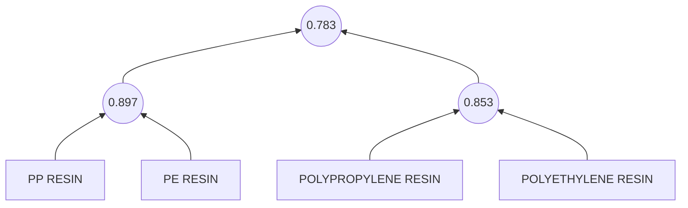
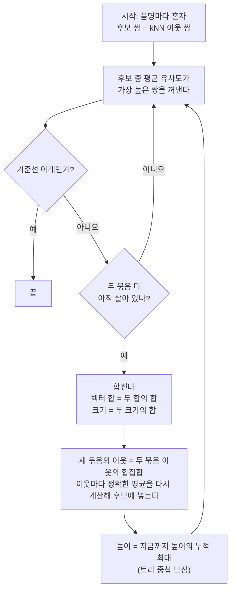
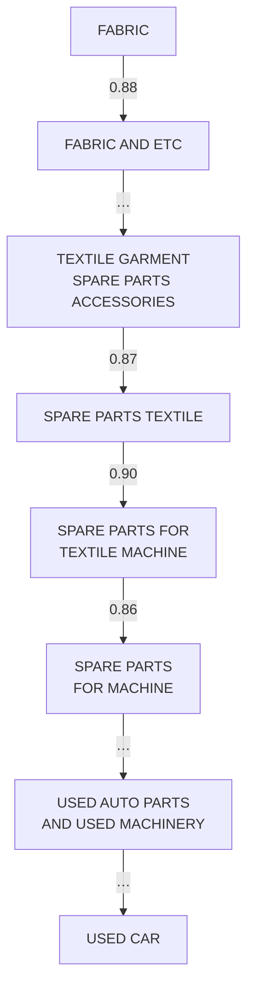

# 3. 평균 연결 트리

## 계층 군집이 하는 일

처음에는 모든 품명이 혼자다. 가장 비슷한 두 묶음을 하나 합치고, 다시 가장 비슷한 두 묶음을 합치는 일을 반복한다. 합칠 때의 유사도를 높이로 기록해 두면 트리(덴드로그램)가 된다.

"두 묶음이 얼마나 비슷한가"를 정하는 규칙이 **연결 방식**이다.

| 연결 방식 | 두 묶음 A, B 의 유사도 |
|---|---|
| 단일 연결 | A 에서 하나, B 에서 하나를 골라 만든 쌍 가운데 **가장 가까운 한 쌍** |
| 평균 연결 | A 에서 하나, B 에서 하나를 골라 만든 **모든 쌍의 평균** |

!!! note "자주 헷갈리는 점"
    평균 연결이 보는 건 두 묶음 **사이**의 쌍이다. 한 묶음 **안**의 쌍 평균은 응집도라는 다른 값이고, 합치는 데는 쓰지 않는다.

## 정확한 평균을 싸게 구하기

모든 쌍을 일일이 세면 묶음이 커질수록 계산이 폭발한다. 그런데 단위 벡터라면 쌍 코사인의 합은 벡터 합끼리의 내적과 같다.

\[
\text{avg}(A, B) = \frac{1}{|A|\,|B|} \sum_{a \in A} \sum_{b \in B} a \cdot b = \frac{\left(\sum_{a \in A} a\right) \cdot \left(\sum_{b \in B} b\right)}{|A|\,|B|}
\]

그래서 묶음마다 벡터 합과 크기만 들고 있으면, 내적 한 번으로 **근사 없이 정확한** 평균 연결 유사도가 나온다.

## 작은 예: 네 품명

[2장](embedding.md)의 네 품명으로 평균 연결을 손으로 돌려 보면 이렇다.

1. 여섯 쌍 중 `PP RESIN`–`PE RESIN` 이 0.897 로 가장 높아 먼저 합쳐진다.
2. 남은 후보는 {PP, PE}–POLYPROPYLENE 평균 0.767, {PP, PE}–POLYETHYLENE 평균 0.799, POLYPROPYLENE–POLYETHYLENE 0.853 이다. 가장 높은 0.853 이 합쳐진다.
3. 두 묶음 사이 네 쌍(0.773, 0.761, 0.761, 0.836)의 평균 0.783 에서 마지막으로 합쳐진다.

0.80 에서 자르면 재질이 아니라 **약어냐 풀네임이냐**로 갈린다. 재질 약점이 이 작은 예에서도 보인다. 0.75 에서 자르면 넷이 한 "레진" 군집이다. 실제 트리에는 주변 품명이 수천 개 있어서 높이는 이 예와 다르다.

## 모든 쌍을 볼 수 없어서: kNN 후보

머리 약 38만 그룹만 해도 쌍이 700억 개가 넘는다. 그래서 품명마다 가장 가까운 이웃 30개를 근사 최근접 검색(HNSW)으로 찾고, **이웃 관계가 있는 묶음끼리만** 합칠 후보로 삼는다. 후보를 고르는 데만 근사를 쓰고, 합칠 때의 평균은 위 공식으로 정확히 구한다.

이 근사의 대가는 검수에서 쟀다.

- 이웃 밖에 있어 합쳐지지 못한 묶음 쌍이 기준마다 수백 쌍 있고, 그 때문에 군집이 바뀌는 BL 은 0.01~0.03% 다.
- 이웃 제한 때문에 나중 병합이 앞 병합보다 유사도가 높은 역전이 약 50회 있었다. 가장 큰 역전도 0.019 로 절단 간격 0.025 보다 작다. 높이는 누적 최대로 고정해서 어느 기준에서 잘라도 군집이 서로 포함된다.
- 이웃 수를 15·60 으로 바꿔도 품목 수준 군집은 거의 같다(ARI 0.97 안팎).

## 단일 연결은 왜 안 되나: 체이닝

단일 연결은 가장 가까운 한 쌍만 비슷하면 합친다. 그래서 A–B, B–C, C–D 가 각각 비슷하면 A 와 D 가 전혀 달라도 한 묶음이 된다. 파일럿에서 단일 연결 0.85 기준으로 실제로 이어진 사슬이다.

고리 15개가 모두 0.85 이상인데, 양 끝 `FABRIC` 과 `USED CAR` 의 코사인은 0.33 이다. 같은 식으로 FABRIC 에서 코팅 원단 → PVC 필름 → LDPE 필름 스크랩 → PLASTIC SCRAP 으로도 이어진다.

같은 숫자에서 가장 큰 군집이 차지하는 BL 비중(파일럿, OpenAI)이다.

| 기준 | 단일 연결 | 평균 연결 |
|---|---|---|
| 0.900 | 6.3% (FABRIC 혼자) | 6.3% (FABRIC 혼자) |
| 0.850 | 38.1% (품명 2.6만 개) | 6.3% (5개) |
| 0.825 | 58.8% (4.3만 개) | 6.3% (7개) |
| 0.750 | 92.5% (8.9만 개) | 6.3% (14개) |
| 0.650 | 98.6% (10.9만 개) | 6.3% (20개) |

평균 연결이 계속 6.3% 인 건 FABRIC 한 그룹이 표본 BL 의 6.3% 를 혼자 차지하기 때문이다.

!!! tip "같은 '유사도 0.65'가 알고리즘마다 다르다"
    단일 연결의 0.65 는 "사슬의 고리 하나하나가 0.65 이상", 평균 연결의 0.65 는 "두 묶음 사이 모든 쌍의 평균이 0.65 이상"이다. 같은 숫자끼리 비교하면 안 되고 각자 가장 좋은 지점끼리 비교한다.

## 평균 연결의 대가: 희석

평균 연결은 체이닝을 막는 대신, 이미 커진 군집에 새 품명이 끼어들기 어렵다. 큰 군집과의 평균은 그 군집의 다양한 품명에 묽어지기 때문이다. 전체 트리에서 약어↔풀네임 쌍의 84% 는 코사인이 0.65 이상인데, 0.65 절단에서 같은 군집에 든 쌍은 27% 뿐이다. 두 품명이 먼저 각자 다른 군집에 들어가 버리면 그 높이에서 만나지 못한다(추정).

## 답해 볼 질문

- 평균 연결 공식에서 벡터 합만으로 정확한 평균이 나오는 이유는?
- 단일 연결의 체이닝과 평균 연결의 희석은 각각 어떤 품명을 손해 보게 하나?
